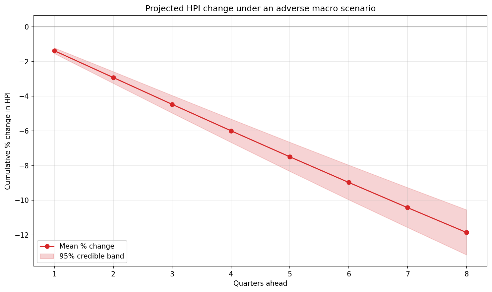

# US House-Price Index: Hierarchical Model & Adverse-Scenario Stress Forecast

A state-level model of the US housing market built on the **FHFA House Price Index**
(2000–2025, 51 regions) and macroeconomic drivers, with a **stress-test forecast**
of how prices would move under an adverse economic scenario.

> **Context.** Coursework for **Math 574 (Bayesian Computational Statistics)** at
> Illinois Institute of Technology, cleaned up and extended for portfolio use. The
> "Bayesian" element is a **normal (Laplace) approximation** to the posterior of the
> model coefficients — not full MCMC — used to propagate parameter uncertainty into
> the forecast.

## Data

Quarterly panel combining regional **FHFA HPI** with national **mortgage rates**
(Freddie Mac PMMS), **unemployment**, **home sales**, **listing inventory**, and
**negative-equity share**. 51 regions (50 states + DC), from 2000 onward (the
write-up uses a panel through 2025). Publishers and terms are in
[`SOURCES.md`](SOURCES.md).

`data/cleaned_housing_data.csv` is gitignored, together with the raw downloads
in `data/raw/`. The panel mixes public series with third-party Case-Shiller,
Realtor.com inventory, and Zillow negative-equity data. `model.py` and
`forecast.py` read that CSV, so rebuild it before running them. This
repository has no notebooks. `tests/test_panel.py` builds a small synthetic
panel, and skips the check of a rebuilt CSV when that file is absent.

### Rebuild `data/cleaned_housing_data.csv`

`preprocessing.py` is the only builder. It reads seven files from `data/raw/`
by these exact names. Create that directory, download each source from the
page in the table, and save it under the name in the first column.

```bash
mkdir -p data/raw
# save the seven files listed below into data/raw/
python preprocessing.py   # writes data/cleaned_housing_data.csv
```

| Save as `data/raw/…` | What `preprocessing.py` reads | Download |
|---|---|---|
| `hpi_master.csv` | FHFA master file. Keeps `hpi_type == "traditional"`, `hpi_flavor == "purchase-only"`, `frequency == "quarterly"`, `level == "State"`. Uses `yr`, `period`, `place_name` (region), and `index_nsa` (HPI). | https://www.fhfa.gov/data/hpi/datasets |
| `Freddie Mac Primary Mortgage Market Survey (PMMS).csv` | CSV with a header row and columns `Week` and `FRM` (30-year rate). Loaded with `pandas.read_csv`. | https://www.freddiemac.com/pmms |
| `HSN1F.csv` | Census new one-family house sales. Columns `observation_date` and `HSN1F`. | https://fred.stlouisfed.org/series/HSN1F |
| `UNRATE.csv` | BLS unemployment rate. Columns `observation_date` and `UNRATE`. | https://fred.stlouisfed.org/series/UNRATE |
| `ACTLISCOUUS.csv` | Realtor.com active listing count. Columns `observation_date` and `ACTLISCOUUS`. | https://fred.stlouisfed.org/series/ACTLISCOUUS |
| `CSUSHPINSA.csv` | Case-Shiller national HPI (S&P Cotality). Columns `observation_date` and `CSUSHPINSA`. | https://fred.stlouisfed.org/series/CSUSHPINSA |
| `NegativeEquity_2017Q1_Public.csv` | Zillow negative-equity file from the Kaggle dataset. Keeps `RegionType == "State"`. Quarter columns must contain `Q` and parse as `YYYYQn` (`RegionName` is the state; year is the first four characters, quarter number starts at index 5). | https://www.kaggle.com/datasets/thedevastator/negative-equity-trends-in-us-housing-markets-201 |

The script keeps dates on or after 2000-01-01, averages the national series to
quarter-end, left-joins them and the state negative-equity share onto state
HPI, forward- and back-fills gaps, clips each numeric series to its 1st–99th
percentile, and adds `log_hpi`, `lag_hpi`, and `hpi_change`.

## Part 1 — Hierarchical model of price levels (`model.py`)

A mixed-effects regression of `log(HPI)` on lagged HPI and macro covariates, with a
**random intercept per state**, fit with statsmodels `MixedLM`. Standardised
fixed-effect coefficients:

| Covariate | Coef. | Reading |
|---|---|---|
| lagged HPI | **+0.319** | strong price momentum (autocorrelation) |
| mortgage rate | −0.040 | higher rates → lower prices |
| unemployment | −0.020 | weaker labour market → lower prices |
| inventory | −0.015 | more supply → lower prices |
| negative equity | −0.011 | distress → lower prices |
| home sales | −0.002 | small |

**R² = 0.957** — but that is largely the lagged term: with the lag removed, the
macro covariates alone explain **R² = 0.47**. The high headline number is mostly
price momentum, and the README/code say so rather than overselling it.

## Part 2 — Adverse-scenario stress forecast (`forecast.py`)

**What "adverse" means here:** mortgage rate 8%, unemployment 6%, home sales 500k,
inventory 1.2M, negative-equity share 15%, held fixed for eight quarters.



Under this scenario the model projects house prices to **fall about 12% over eight
quarters** (two years):

| Quarter | 1 | 2 | 4 | 6 | 8 |
|---|---|---|---|---|---|
| Cumulative % change | −1.4% | −2.9% | −6.0% | −9.0% | **−11.9%** |
| 95% band (Q8) | | | | | [−13.1%, −10.6%] |

**A modeling note (and fix).** HPI is close to a random walk, so a model of the
price *level* cannot be recursed forward without blowing up numerically. The
forecast therefore models the quarterly **growth rate** (log return) as a function
of the macro scenario and cumulates it — the standard, stable way to build a
multi-step stress projection. The growth model's R² is a realistic **0.28**
(quarter-to-quarter growth is hard to predict), but it yields a sensible, bounded
decline rather than a runaway path.

## Run it

```bash
pip install -r requirements.txt
python preprocessing.py   # rebuild data/cleaned_housing_data.csv (see Data)
python model.py           # hierarchical level model: coefficients + R²
python forecast.py        # adverse-scenario projection + chart
```

`model.py` and `forecast.py` read the rebuilt `data/cleaned_housing_data.csv`.
This repository has no notebooks.

## Methodology notes & limitations
- **"Bayesian" = normal approximation.** Coefficient uncertainty comes from the
  asymptotic normal (Laplace) approximation of the fitted model, sampled 1,000
  times — not MCMC with explicit priors.
- **The forecast band is parameter uncertainty only.** It reflects uncertainty in
  the coefficients, not residual/observation noise or state-level random-effect
  draws, so it is narrower than a full predictive interval.
- The mixed model reports a boundary/convergence warning (the region random-effect
  variance is small relative to residual variance); the fixed-effect estimates are
  stable.
- Single adverse scenario, national average across states; not a substitute for a
  full regulatory stress model (e.g. CCAR/DFAST).

## Repository layout

```
hpi-hierarchical-forecast/
├── preprocessing.py     # build the quarterly panel from raw sources
├── model.py             # hierarchical (mixed-effects) level model
├── forecast.py          # adverse-scenario growth forecast + chart
├── data/raw/            # downloaded sources (gitignored; not in the repo)
├── data/cleaned_housing_data.csv   # written by preprocessing.py (gitignored)
├── tests/test_panel.py  # synthetic panel; skips when the rebuilt CSV is absent
├── figures/adverse_forecast.png
├── SOURCES.md
├── requirements.txt
└── LICENSE
```

## License
The code is [MIT](LICENSE). FHFA HPI (US government work; Source: Federal Housing Finance Agency, FHFA HPI®) and Census/BLS series are public. Freddie Mac PMMS is used with attribution (© Freddie Mac). Case-Shiller (S&P Cotality), Realtor.com inventory, and Zillow negative-equity data are third-party and remain under their owners' terms; they are not redistributed here and are not covered by the MIT license. Zillow data © Zillow Group, via Kaggle. See [SOURCES.md](SOURCES.md).
